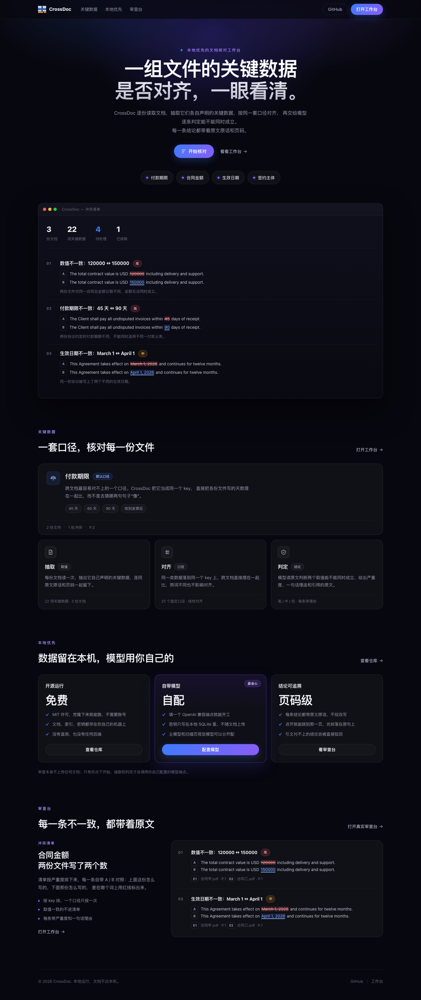

# CrossDoc 主页

产品主页。结构与视觉参考 [verge-ai.xyz](https://verge-ai.xyz/)：深色底 + 紫蓝辉光、超大粗体标题、
eyebrow 小字、玻璃拟态卡片、浏览器窗口 mock、三段式 section 节奏。内容全部换成 CrossDoc 自己的。

```
site/
  index.html          页面结构
  styles.css          样式与设计 token
  preview.png         桌面宽度全页预览
  assets/
    crossdoc-logo.svg 深色背景版 logo（app 里那版是墨色，深底上看不清）
```



## 本地预览

```bash
cd site && python3 -m http.server 5180
# → http://localhost:5180/
```

纯静态，没有构建步骤，也没有依赖。`site/` 目录本身就是一个可发布的静态站点。

## 改应用地址

「打开工作台」和「开始核对」指向本地跑起来的 app，默认 `http://localhost:5177/`。
改地址的地方：

- `site/index.html` 顶部有注释标记，所有指向 app 的链接
- 部署到公网时，把它们换成实际部署后的应用地址

## 与 app 的关系

主页是静态的，不依赖 app 运行。app 本体仍然是 `public/`，由 `src/server.ts` 提供服务，
工作台在 http://localhost:5177/ 。两边共用 `public/crossdoc-logo.svg` 的图形语言，
主页用的是深色版。

## 发布

`site/` 里有 `index.html`，可以直接作为静态站点发布。发布前记得：

1. 把「打开工作台」指向可访问的应用地址
2. 确认 `assets/crossdoc-logo.svg` 随站点一起上传
3. 仓库是 PUBLIC，发布到公网后任何拿到链接的人都能看到
